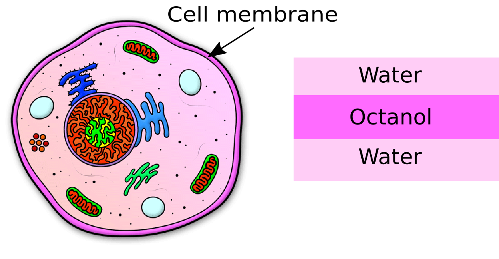
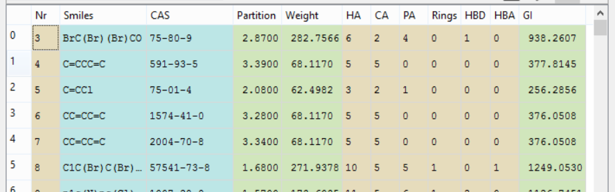
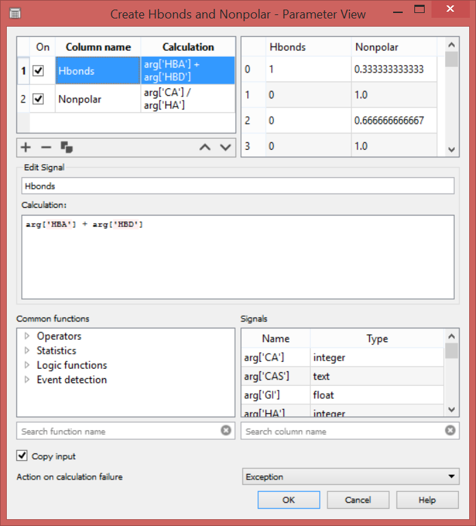
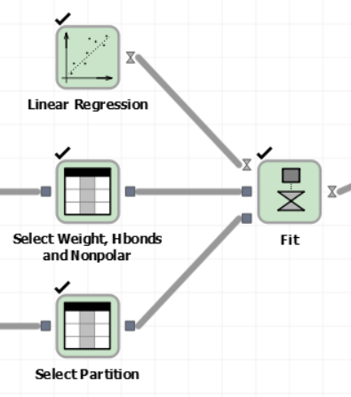
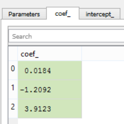
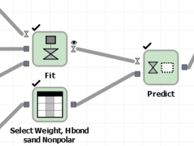
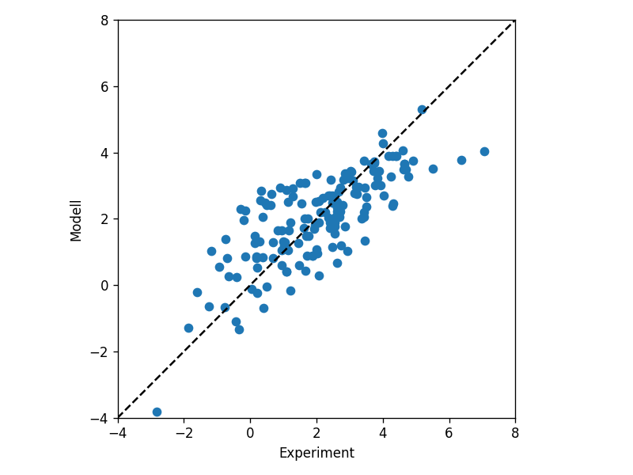

Life is complicated, you probably know that. If we take a magnifying glass and look at a living thing from a chemical and biological perspective, it is astonishingly complicated. In this blog post, I will walk through an example of a process that occurs in all living things and how we can study this process with a computer. In fact, I will demonstrate that by using clever approximations, simple statistics and robust software, life does not have to be complicated.

## **Setting the stage**

The process that we will look at is the _transport of small molecules over the cell membrane_. That sounds complicated, I know. So let me explain a little bit more. Each cell, in every living organism, is surrounded by a membrane that is essential for cell viability (see Figure below). It is also important for the cell to transport small molecules across the membrane. This can be for example nutrients, waste or signals.

If we can understand this process, we can utilize it to our advantage. We can design new drug molecules that enter the cell, fix the broken cell machinery and heal diseases. We can also design better biofuel-producing cells and assess environmental effects, but that is another story.



Here, we want to estimate _how fast_ a molecule is transported. We will use the following assumptions that make the modeling much easier:

- We will assume that the small molecules cross the membrane by themselves
- We will approximate the membrane as a two-phase system, ignoring any chemical complexity
- We will model one phase as water and the other as octanol, an alcohol (see Figure above)

By making these assumptions, we can reduce our problem to estimate the probability of finding the small molecule in octanol compared to water. In technical language, we are talking about _a free energy_ or a _partition coefficient,_ but it is good to keep in mind that this is nothing but a probability.  

## **A** **multivariate** **regression** **model**

We will use a very simple linear regression model to predict partition coefficients. You will soon see that this is a surprisingly good model.

In a regression model, we are trying to predict an unknown variable _Y_ given some data _X_. This is done by first training the model on _known_ _X_s and _Y_s. In the lingo of machine learning _X_ is called features and is some properties of the system from which we can predict _Y_. So, what are the features of our problem?

Recall that we are trying to predict partition coefficients of small molecules, so it is natural to select some features of the small molecules. There are many features available – over one thousand have been used in the literature!

We will use three simple features that are easy to compute:

1. The weight of the molecule
2. The number of possible hydrogen bonds (it will be called _Hbonds_)
3. The fraction of carbon atoms in the molecules (_Nonpolar_)

If a molecule consists of many carbon atoms, it does not like to be in the water and prefers octanol. But if the molecule, on the other hand, can make hydrogen bonds it prefers water to octanol.

Our regression equation looks like this:

```
"Partition coefficient" = c0 + c1"Weight" + c2"Hbonds" + c3"Nonpolar"
```

and our task is to now to calculate _c_0, _c1_, _c2_, and _c3_. That is just four parameters – didn't I say that life wasn't so complicated!

We will use a database of about 600 molecules to estimate the coefficients (training the model). This database consists of experimental measurements of partition coefficients, the known _Y_s. To evaluate or test our model we will use some 150 molecules from another database with measured partition coefficients.

## **Sympathy for Data**

To make and evaluate our model, we will use the open-source software [Sympathy for Data](https://www.sympathyfordata.com/). This software has capabilities to for example read data from many sources, performing advanced calculations and fitting machine learning models.

First, we will read in a table of training data from an Excel spreadsheet.


And if one double-clicks on the output port of the Table node, we can have a look at the input data.



The measured partition coefficient is in the _Partition_ column and then we have several feature columns. The ones that are of interest to us is _Weight, HA_ (heavy atoms), _CA_ (carbon atoms), _HBD_ (hydrogen bond donors) and _HB__A_ (hydrogen bond acceptors).

From _HA_ and CA, we can obtain a feature that describes the fraction of carbon atoms, and from _HBD_ and _HBA_, we can calculate the number of possible hydrogen bonds. These feature columns will we calculate using a Calculator node.



In the calculator Node, one can do a lot of things. Here, we are creating two new columns _Hbonds_ and _Nonpolar._ These columns are generated from the input table.

Next, we are using the machine learning capabilities of Sympathy for data to create a linear model. We are selecting the _Weight_, _Hbonds__,_ and _Nonpolar_ columns as the _X_ and the _Partition_ column as the _Y_.



If one double-clicks on the output port of the Fit node, we can see the fitted coefficients of the model.



Remember that many hydrogen bonds tell us that the molecule wants to be in the water (a negative partition coefficient) and that many carbon atoms tell us that the molecule wants to be in octanol or the membrane (a positive partition coefficient). Unsurprisingly, we see that the _Hbonds_ column contributes negatively to the partition coefficient (_c_2\=–1.21) and the _Nonpolar_ column contributes positively to the partition coefficient (_c_3\=3.91).

How good is this model? Let's read the test data and see! There is a Predict node in Sympathy for data that we can use to evaluate the _X_ data from the test set.



By using another Calculator node, we can compute some simple statistics. The mean absolute deviation between the model and experimental data is 0.86 log units, and the correlation coefficient _R_ is 0.76. The following scatter plot was created with the Figure from Table node.



This is a rather good model: first, the mean deviation is less than 1 log unit, which is about the experimental uncertainty. That is, we cannot expect or trust any lower deviation than this because of experimental error sources. Second, the correlation is significant and strong. It is possible to increase it slightly to 0.85 – 0.90, using more or very advanced features. But what is the point of that? Here, we are using a very simple set of features that we easily can interpret.

What's next? You could use this model to predict the partition coefficient of a novel molecule. Say you are designing a new drug molecule and want to know if it has good transport properties. Calculate three simple features and plug it into the model, and you have your answer!

* * *

The data and the Sympathy for data flows can be obtained from Github: [https://github.com/sgenheden/linear\_logp](https://github.com/sgenheden/linear_logp)

If you want to read more about multivariate linear regression: [https://en.wikipedia.org/wiki/General\_linear\_model](https://en.wikipedia.org/wiki/General_linear_model)

If you want to read more about partition coefficients: [https://en.wikipedia.org/wiki/Partition\_coefficient](https://en.wikipedia.org/wiki/Partition_coefficient)

The picture of the cell was borrowed from [www.how-to-draw-cartoons-online.com/cartoon-cell.html](http://www.how-to-draw-cartoons-online.com/cartoon-cell.html)
