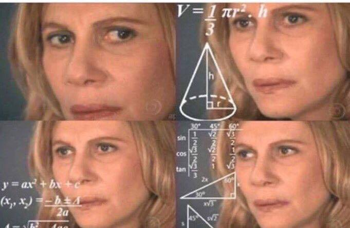

<Disclaimer: my opinions are my own. Situations depicted in this blog are not intended to depict any former, current or future employer, or any particular person or minority>

Nature is beautiful. Can we make sense of the forest while still keeping track of the sick trees? Forest [Photo](https://stocksnap.io/photo/mountain-valley-LKNSJW6Y2B) by [Jeroen Bendeler](https://stocksnap.io/author/36623) on [StockSnap](https://stocksnap.io/)

Tuesday morning. You get a cup of <insert beverage> and zombie-shuffle your way into your desk. After opening emails, you see it is now possible to access that awesome dataset (which is totally necessary for world domination improving your segmentation scores!).

Soon you notice a catch: this dataset is undocumented, as-is provided and Humongous (the term Big Data chocked on a tide pod last decade). But at least the names are self-explanatory and they include units. Alright. Exploratory analysis commences: ranges, missing values, duplicates, and all endemic critters in between get pulled. You throw in univariate quantiles and a correlation matrix for good measure. We have now learned a thing or two about this dataset.

While exploring some more, there seem to be some things unexpectedly off with this dataset. Like, values that are physically impossible but there they are. Or things that could \*in principle\* be valid values but are not. Or things that you can see how they got to be logged the way they are, but the circumstances around it are hard to track.

<figure>

<figcaption>

Wait, what?

</figcaption>

</figure>

Unsure of how to proceed, you reach back to the maintainer of this dataset. It is a person (yay!) that agrees on the fact that the data is undocumented (ok?), adds that it will not be documented anytime soon (oh...) then sends you home with a few pointers and gotchas.

**Formula does not parse**

What are we supposed to do now? ignore all data quality problems? refuse to do anything until we are sure its clean? Is this data wrong?

Let's take this last rhetoric question and rephrase it into something measurable: HOW MUCH can you expect this data to be wrong? Most importantly: What is your level of confidence that your estimation of data "wrongness" is within a range that you deem as "workable"?

Enter: Binomial proportions, confidence intervals, margins of error. In this post, we show how a sample can be used to assess the percentage of your data affected by the kind of data quality problems which are otherwise expensive to detect over an entire dataset, using confidence intervals over binomial proportions.

Binomial proportions emerge when we make $latex N$ independent trials in which the outcome is either "1" or "0", then sum all the cases in which we had a "1" and call that $latex x$. Then we divide $latex x$ by the number of trials $latex N$. The kicker is that all trials have the same probability $latex P$ of having "1" as an outcome. There are two concepts here: first, the distribution of $latex x$ is none other than a [binomial distribution](https://en.wikipedia.org/wiki/Binomial_distribution). Hence "binomial" proportions ;). Second, that we turn $latex x$ into a proportion $latex P$ the moment we divide it by $latex N$.

You can quickly see how can binomial proportions be useful for modelling data quality: If you allow the presence (or not) of a failure in a section in your dataset to be modeled as an independent Bernoulli trial in which every $latex N$th section of your dataset has the same probability $latex P$ of failing, then the probability for any number of failures can be modeled with a Binomial distribution, and turned into a binomial proportion when divided by $latex N$.

Binomial Distributions have two parameters: $latex N$ is the number of Bernoulli trials and $latex P$ is the probability of a positive outcome (in this case, finding a defect) on each trial. As you may guess, the expected value of this distribution is simply the product of $latex N$ and $latex P$. There are a lot of other interesting, well-behaved properties about this distribution, [feel free to look in here](https://en.wikipedia.org/wiki/Binomial_distribution) or in [this video](https://www.youtube.com/watch?v=8idr1WZ1A7Q) for more (and note that capital letters are used in this post when referring to the parameters of the Binomial distribution :))

Now we know that $latex x$ is distributed as a binomial, but how do we know the value of $latex P$?.

With a confidence interval over a binomial proportion $latex P$, one can say that if we make many many samples and take proportions out of them, then those samples will hit close to the population proportion within that confidence interval of width $latex W$ on $latex 1-\\alpha$% of the cases. That $latex \\alpha$ is the good'ol confidence level.

Now, you do know how big your dataset is (sort of). You can pick [some expression for confidence intervals](https://en.wikipedia.org/wiki/Binomial_proportion_confidence_interval) of binomial proportions that accepts some parameters reflecting the inner struggles of how "wrong" do you expect this dataset to be (e.g. desired confidence levels and margins of error) and use this expression to extract a sample size.

When you look at [the many methods](https://en.wikipedia.org/wiki/Binomial_proportion_confidence_interval) available for estimating confidence intervals in binomial proportions, you can quickly notice that an underlying assumption in many of these methods is that the size of your dataset (number of Bernoulli trials) is sufficiently big, [so again, references to the central limit theorem are made](https://openstax.org/books/introductory-business-statistics/pages/7-3-the-central-limit-theorem-for-proportions), which allows connecting the expected value of the proportion of defects of a sample, with that of the entire dataset, and with some Z score (derived from Standard Normal Gaussians). You can use the knowledge from your exploratory analysis to get a grasp of which of these methods should NOT be used on your dataset.

Now, if you don't have that kind of time in your hands :) and you have some reasonable information that the errors are non-zero and non-total, you can carry on [with a confidence interval expression like this](https://en.wikipedia.org/wiki/Sample_size_determination), built with the Wald method:

$latex (\\hat{p} - Z\\sqrt{\\frac{p(1-p)}{n}}, \\hat{p} + Z\\sqrt{\\frac{p(1-p)}{n}})$

This expression centers our confidence interval in $latex \\hat{p} $ with +/- $latex Z\\sqrt{\\frac{p(1-p)}{n}} $, and the total with of that confidence interval is in percentage points and we can call it $latex W$:

$latex \\frac{W}{2} = Z\\sqrt{\\frac{p(1-p)}{n}}$

In this context, $latex n $ is the sample size that we want to get, which will be used to estimate $latex \\hat{p} $ - our unknown proportion of errors in the dataset. If we have an educated idea of the ballpark of $latex \\hat{p} $, we can go ahead and plug it in this expression. And if we don't, we can use the maximum value of $latex p(1-p)$ which is 0.25 (for p=0.5).

Regarding $latex Z$, you will notice that it kindof reminds you to the Z score given a distance from the mean of a normal distribution. It is in fact the two-tailed quantile for a confidence of $latex \\alpha$. This means that is the quantile of $latex 1 - 0.5\\alpha$. An alpha of 5% will yield the quantile of 0.975 of the standard normal distribution because $latex 1 - 0.5\*0.05 = 0.975 $. For more on how this affects the sample size, [feel free to look at the first part of this notebook](https://github.com/lia-statsletters/youtube_play/blob/main/video_0_sampling/sample_size_plots.ipynb).

Now, suppose that you really don't know if you have 2% errors (something you can accept) or 15% (which you probably may not want to work with...). Then you can take $latex p(1-p) = 0.25$, which makes then former expression of W look super simple:

$latex W^2 = \\frac{Z^2}{n}$

And solving this for $latex n$ you get:

$latex n = \\frac{Z^2}{W^2}$

Then feel free to choose how wide do you want your confidence interval $latex W$ to be, and for which kind of confidence level do you want the estimation to fall onto.

You can get a grasp at sample sizes for the this specific case of $latex p(1-p) = 0.25$ on the figure below (which was [generated with the code in the second part of this notebook](https://github.com/lia-statsletters/youtube_play/blob/main/video_0_sampling/sample_size_plots.ipynb))

There are a few things that you can already notice. First, the sample size increases drastically from 3% to 2% and then to 1% $latex W$. This can be important depending on what the actual error of the dataset turns out to be, or on the information you have available a-priori: what if you know you can expect a very bad percentage of errors in your data (say 20%!) or a very small one? What do you do then?

Or how would your calculations change if the assumption of the same probability of error for all parts of your dataset would no longer be reasonable?

Remember that sampling ALWAYS implies some uncertainty. What we are doing here is getting a sample so that we can have some information and decide if its worth our time and effort to continue working with a dataset or not. You can make this an exercise for your enjoyment :) or you can get a quick, reasonable answer before committing even more.

Enjoy! Go say hi to your local Data Person!
