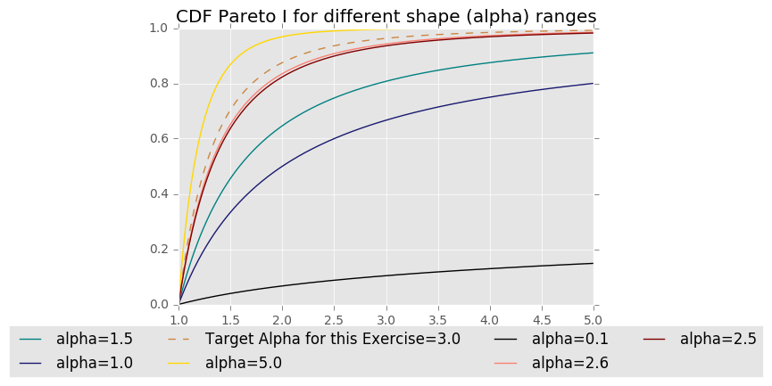
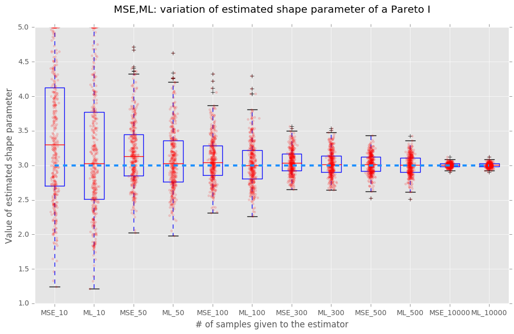

The maximum spacing estimation (MSE or MSP) is one of those not-so-known statistic tools that are good to have in your toolbox if you ever bump into a misbehaving ML estimation. Finding something about it is a bit tricky, because if you look for something on MSE, you will find "Mean Squared Error" as one of the top hits. The wikipedia page will give you a pretty good idea, so [click here to check it while you are at it](https://en.wikipedia.org/wiki/Maximum_spacing_estimation).

Here is a summary for the lazy: MSE or Maximum Square Estimation is about getting the parameters of a DF so that the geometric mean of "spacings" in the data are maximized. Such "spacings" are the differences between the values of the cumulative distribution function at neighbouring data points. This is also known as the Maximum Product of space estimations or MSP, because that is exactly how you calculate it. The idea is choosing the parameter values that make the observed data as uniform as possible, for a specific quantitative measure of uniformity.

So we can explain what happens here by means of an exercise. Of which we made a [notebook on our github (click here)](https://github.com/lia-statsletters/notebooks/blob/master/MSE%20\(Maximum%20Spacing%20Estimation\).ipynb). Suppose we have a distribution function. We start with the assumption of a variable X with a CDF , where  is an unknown parameter to be estimated, and from which we can take iid random samples. The spacings over which we will estimate the geometric mean () are the the differences between  and , for i \[1,n+1\]. For the giggles, let's say our df is a Pareto I, with some shape parameter α=3.0 and a left limit in 1. This α is the θ parameter that we intend to estimate. We can draw some samples from our distribution and construct a CDF out of the samples. We can do a similar process for other values of shapes, and plot those CDFs together, which will end up looking like this:



The first thing you will observe is that the bigger the alpha, the "closer to each other" this distributions look. For instance, the CDFs for α=5.0 and α=2.5 are much more closer to each other than the CDFs for α=2.5 and α=1.0. And that is an interesting fact to consider when using this estimator. It will probably be easier to get a "confused" result the higher the α parameter gets. So α=3.0 is not exactly the easiest choice of values for "messing around and looking at how our estimator behaves", but is not too difficult either.

Now, back to the estimator. In this post we made a very simple exercise to look at how ML and MSE behave when estimating a value of an α parameter in a Pareto I distribution. The choice of shape parameter and distribution are completely arbitrary. In fact, I encourage you to take my code and try other distributions and other values yourself. Also to make my small laptop's live easier, selected a subset of α values over which the search was made. Then, we obtained the best scores on each method for different sample sizes:

```
10,50,100,300,500,10000
```

And for each sample size and each method, we repeated the estimation 400 times. So, a box-and-whisker plot of this estimation together with a scatterplot for each sample size and each method can be seen here:



The dotted line in α=3.0 is where the shape parameter of each original sample is. As you can see here, ML behaved much better than MSE for small sample numbers. In both cases for small numbers of samples there was some skewness towards the bigger values. This is expected since the CDFs of this distribution get closer the higher the value of the shape parameter. ML also behaved better than MSE for 50, 100 and 300 samples. Now, this was only one result for this distribution and for α=3.0. A more definitive quantitative evaluation would require looking at more distributions, and at different points of those distributions. There was a paper suggesting that "J" shaped distributions were the strong point of MSE. I guess a more thorough quantitative valuation of MSE vs ML would be in order for a decision here. And it will also be worthy of a journal paper in addition to a small blog post such as this one ;). You can cite me too if you like to use my code ;).

When I first found this estimator I have to admit that it caused a bit of infatuation in me. Some mathematical concepts carry themselves with such beauty that you can't help feeling an attachment. And you see everything about them with rose-tinted lenses. It made me wonder why on earth is this concept not as well known as ML. It is not super much more expensive depending on how you calculate it. For ML you need a density function, while for MSE all you need is a cumulative distribution function. And that alone is a powerful point, because all random variables have a CDF, but not all have a PDF. Granted, most distributions you will work with will probably have a PDF. Granted, ML is the workhorse for estimators, many toolboxes have it implemented. And is super easy to teach to undergrads. And it works well. In fact, it worked better than MSE for this particular example. So in spite of all the beauty, maybe the fitness function for mathematical concepts to last posterity is not beauty or elegance, but applicability.

[BONUS POINTS IF YOU ARE LOOKING TO WORK WITH US](http://statsletters.com/2017/01/07/special-announcement-we-are-hiring/): Blow my mind. Try this exercise in other distributions. Make other comparisons. Make me stop loving MSE. Or make me love it even more. I have to do something about the butterflies in my stomach! You are my only hope!

As always, you can find the code for generating the plots of this post in [our notebook (click here)](https://github.com/lia-statsletters/notebooks/blob/master/MSE%20\(Maximum%20Spacing%20Estimation\).ipynb).

Image taken from [stocksnap.io](https://stocksnap.io/photo/CYM0B08W5E).
