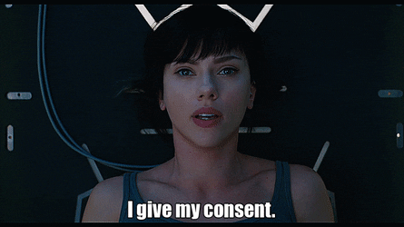

Or "Serpent people".

The old saying goes something on the lines of "you are what you eat". On modern societies the sentiment shifts towards "you are what you buy". Which may include food, of course.

One important difference since a decade ago is _what_ can be measured about _how_ a user consumes a product. Lately, it seems like every little thing that we do can be used to build a projection of ourselves from our habits. And in the end, that projection can be used to poke the reptilian parts of your reward circuitry so they release the right cocktail of hormones. A cocktail that makes you choose bright red over dull gray, reach for your wallet or click "I accept the terms and conditions".

Through the years, recipes for such cocktails have been perfected by different disciplines. As an educated consumer, actively tasting those recipes in modern products can be as interesting as wine tasting, minus the inebriation. This is the first of a series of posts intended to help you be more aware of your own reward circuitry by using interpretations that different algorithms build from observing your _measurable_ actions.

Another intention with this series of blog posts is to show that the methods are not necessarily:

- Absolute
- Inherently objective
- Infallible

And definitely NOT suitable to use blindly e.g. "press the Analytics Button and have the neural network tell me everything"\*. If anyone promises that without disclosing any assumptions, make sure to ask LOTS of questions.

The "Serpent people" series will present some textbook representations suitable for modeling this problem, aspects that are better reflected on each one of them, and trying out different open-source libraries on different artificially generated models of "people according to what we know about them".

Some of that material is already in a very _fluid_ shape in [this notebook](https://github.com/lia-statsletters/notebooks/tree/master/people) if you can't wait to play by yourself :). The representation in there is simply what I considered to be natural for the problem itself. I plan on elaborating that representation with classics such as Frequent Itemset Mining and Associative Classification. For those, you can start by checking out Chapter 10 of "Data Mining" by Mehmed Kantardzic.

And that's the teaser for what will come. For now, I will leave you with this [David Bowie Song](https://www.youtube.com/watch?v=VpdHMaccjw4). Granted, it's "Cat People" instead of "Serpent People", but pretty cool still.

See you next post!

/\* This sentence is partially credited to one of my friends while discussing technology sales gore.
