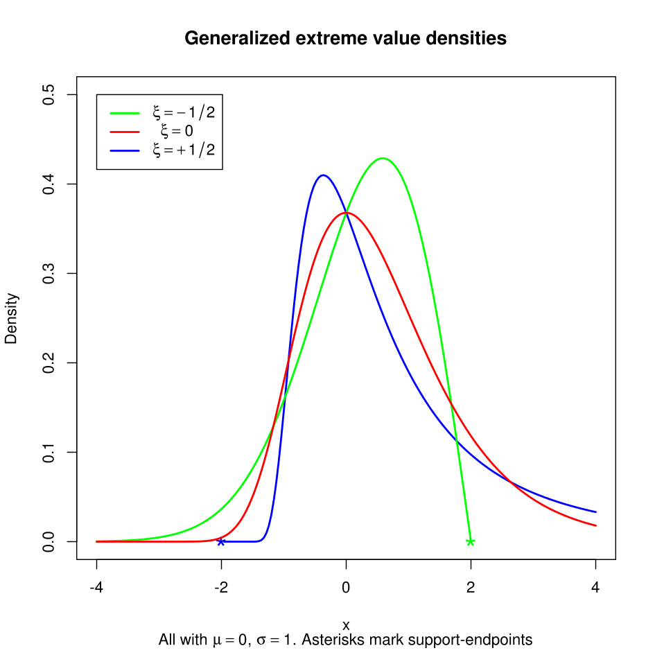

> A handful of times in our lives, we can't take our eyes out of something. Something so rare that we just want to keep our eyes on it one last instant before it vanishes. And when it does, the air slowly leaves our lungs and we wonder when will we ever experience something like that again.

 

### 

### What ?

_Clears throat_ what I actually mean is that every now and then, a data science practitioner will be tasked with making sense out of rare, extreme situations.

The good news is, there exist mathematical tools that can help you make sense of extreme events. And some of those tools are structured under a branch of probability which has (conveniently) been named Extreme Value Theory (EVT).

Extreme value theory is concerned with limiting laws for extreme values in large samples. And this is a very important point: it requires LARGE amounts of samples, otherwise the errors for our estimations may become arbitrarily big.

### How does that work?

An important concept on top of which extreme value theory builds upon, is the idea of a Maximum Domains of Attraction (MDA).

An analogy useful to explain MDAs is the idea of the Central Limit Theorem (CLT). If we recall, according to CLT, if you split a sequence into chunks of size n, the distribution of the means of those chunks will be gaussian. And the mean of such distribution (a.k.a. the distribution of sample means) will converge to the mean of the original sequence. For MDA, given the same sequence split into chunks, one can extract the maxima of each chunk and build a normalised sequence out of it (lets call that sequence Mn).

The super awesome result here, is that one can extract a CDF of normalizing sequences so that (Mn - dn)/cn converges in a certain distribution F^n (cn\*x + dn) -> H(x). And that CDF named Fn ∈ MDA of H. All common continuous distributions are in the MDA of a GEV distribution. The restrictions on the "normalisers" are that cn>0. Under certain circumstances, cn and dn have simple analytical forms.

The awesomeness does not stop there. H follows a very specific type of distribution. And guess what. That distribution is NOT a Gaussian.

 

\[caption id="attachment\_2457" align="aligncenter" width="480"\] Now, remember all the ranting in previous posts about overusing gaussians?\[/caption\]

Let me gorge a bit on that. Because this is a paradigm shift. Usually, your average practitioner will run, fit a gaussian, choose a multiple of a standard deviation, and claim "hic sunt dracones" (which is an oversimplification of univariate statistic process control). There seems to be nothing wrong with that right? except that it does not make much logical sense to try to define the extreme by defining the normal, if you think about it. I mean, you know quite a lot about what is normal. And you know that the extreme is not normal, but that's about it. Without extreme value theory, you will otherwise have a huge question mark.

All right, back to the subject matter. Such distribution for H is known as the Generalized Extreme Value distribution (GEV). The GEV can be determined by two parameters: location and shape ξ. We can use any known techniques (e.g. MLE) to fit the parameters. The shape parameter ξ can used to describe the tail of H. The larger ξ -> Heavier tails.

- For ξ > 0 case, H is a heavy tailed Fréchet.
- For ξ < 0 case, H is a short tailed Wiebull.
- For ξ = 0 case, H is an exponentially decaying Gumbel.

You can see the differences by looking at the following plot (obtained from [here](https://en.wikipedia.org/wiki/Generalized_extreme_value_distribution#/media/File:GevDensity_2.svg)):

### 

### How do I use this?

There are two main methods: Block Maxima, and Peaks-over-Thresholds. For the first method, maximum points of selected blocks are used to fit the distribution. For the second, all values above a high level u are used. Each method can suit different types of need.

#### Block Maxima

The block maxima method is very sample hungry, since it consists on splitting the data in n-size chunks, and using only one element in each chunk. The choice of n is affected by bias variance tradeoff (bigger blocks diminishes bias, more blocks diminishes variance). Finally, there is no specific criteria for selecting n. However, on datasets in which a partition goes naturally, this could actually be used in lack of better information (for instance, when studying extremes in cyclic phenomena).

#### Peaks-Over-Thresholds

The Peaks-over-thresholds method is known to be less sample hungry. It consists on setting a threshold u, and using all points in the dataset above that level for constructing the model. And fortunately there exists a (graphical) statistic method for selecting u via finding the smallest point of linearity in a sample mean excess plot. Once a model is fitted for threshold u, we can infer a model for a threshold v > u. Yet applying the graphical method is tricky since the sample mean excess plot is rarely visibly linear. One should always analise the data for several thresholds. And this method will not give a (proven) optimal choice.

### So, what's the veredict?

You don't need to stand on the line between serendipity and vicissitude as long as you have sufficient data, thanks to the mathematical developments in extreme value theory. This blog intends to tease you so that you look more into this topic yourself, if this sounds like something that could help you in your professional life. The author recommends looking at the wonderful chapter on EVT at http://www.qrmtutorial.org/slides. They also have examples in R, that you can play with yourself!

The featured image in this post was borrowed from [here](https://stocksnap.io/photo/9WTNHBFJUX).
