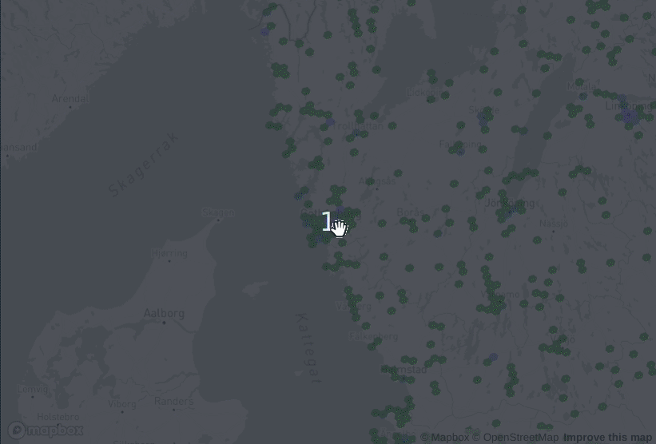

How many of you ever played a game called Civilization? To those who have not, it's an amazing game of strategy in which you play a civilization with certain beliefs and features. There is a PC, console and a board game version. In the PC game you start as a single settler unit, found a city and develop an empire. There are other empires that compete for resources - you are not alone in the world and can in fact, be [nuked by Ghandi](https://knowyourmeme.com/memes/nuclear-gandhi). For a taste of epicness, see the trailer below.

<figure>

https://www.youtube.com/watch?v=wCk\_oJW--eI

<figcaption>

"It is the nature of humankind to push itself against the horizon \[...\] We face our fears. We rise to the challenge. And become something greater than ourselves: a civilization.

</figcaption>

</figure>

As an experienced board game player, you are probably used to having a game map with areas containing resources. Typically, strategy involves securing those resources so the empire gets stronger, then [crush your enemies and hear the lamentations of their women](https://en.wikiquote.org/wiki/Conan_the_Barbarian_\(1982_film\)).

So how do things go when the world is your game map? Goals may look a bit different. It can be something casual such as choosing a place for a picnic with friends. Or a big thing, such as picking a place to build your dream home. What we want to accomplish at the end of this blog post is something like this:

<figure>

https://i.redd.it/s8aqkxwhbs5z.jpg

<figcaption>

Hexagonal tiles with icons in them marking the kinds of resources you can find in that area

</figcaption>

</figure>

In either case, we will need two things:

- Some way to partition the world in tiles, to facilitate characterizing places (Enter H3!)
- Some way to get the information we need about the world (Enter Public Data!)

You may have observed things such as zipcodes, postcodes, neighborhoods, administrative divisions, and all sorts of taxonomies in between, and on many cases those partitions vary between different places in the world. Those differences are fascinating, yet impractical :).

Finding the absolute best way to tile the world will probably consume your life. A happy middle for most practical purposes is expected to satisfy this:

- Named tiles e.g. tile fff40 will always be in the same place, with the same size and shape.
- The possibility to have different sizes of tiles, so you can switch between coarse or fine aggregations.
- Pretty good coverage of the world.

The problem for most of us is that we are not super knowledgeable on how to partition the world. In fact, I know so little about it that I just regurgitate facts back to others, such as "you cannot cover the whole world in only hexagons, you will need at least some pentagon somewhere" and so forth. Fortunately, some really smart people have created something they call a "Hexagonal Hierarchical Geospatial Indexing System", which you can use to partition the world into \*mostly\* hexagonal tiles of different sizes. This shortens to [H3](https://h3geo.org/), and ticks all the boxes :).

## Enter H3

Taken from [their docs](https://h3geo.org/docs):

> The **H3** geospatial indexing system is a multi-precision hexagonal tiling of the sphere indexed with hierarchical linear indexes. The **H3 Core Library** provides functions for converting between latitude/longitude coordinates and **H3** geospatial indexes.

This means:

- You get the world tiled as hexagons on a sphere!

- You get [a choice of resolutions for the tiles](https://h3geo.org/docs/core-library/restable)

- The tiles are indexed

- Planned use cases involve finding any given tile index given a lat,lon pair, and getting tile centers / boundaries for a tile index.

and,

> The **H3 Core Library** is written entirely in _C_. [Bindings for other languages](https://h3geo.org/docs/community/bindings) are available

Which means:

- The core runs in C so things will probably be pretty fast

- Once can access the library through bindings in other languages (e.g. Python)

This is awesome! Python is lingua franca for many Data Science packages so this will make everything easier. For getting the python bindings, it cannot be easier. Just do `pip install h3` or `conda install h3-py` from forge. [Check out the repo](https://github.com/uber/h3-py) for cool examples and docs.

And just to get an idea of how easy it is to work with this library, check out this snippet in which we append columns to a geodataframe containing the H3IDs of tiles in which a lat,long point is located, given resolutions 4,6 and 8:

```
for resolution in (4,6,8):
    gdf_amenity[f'h3id_{resolution}']=[h3.geo_to_h3(gdf_amenity.lat[x],
             gdf_amenity.lng[x],resolution) for x in gdf_amenity.index]
```

See how simple it was?

If you are interested on the actual math of the tiles and the places where you are likely to find pentagons and other distortions, [check out this very interesting Observable](https://observablehq.com/@fil/h3-oddities). Also, check out the video below for use cases that motivated creating H3 in Uber.

https://youtu.be/0OlIpNAqokQ

And now that we have our tiles, let's find some data to characterize them :)...

## Enter Public Data

What do you do when you need to find a toilet on an unknown place? you take out your phone and try to find a public toilet -as the archetypal city slicker. But depending on the part of the world you are and the service you use, sometimes that may not be available. What if you were looking for something else? such as drinking water, a bench or a waste basket? What if you wanted to get an idea of the density of restaurants, schools or parking lots? What if you wanted to know typical areas with air pollution? Note that many of these things you could \*gauge\* by looking at most mapping apps out there, but you may not want to have an app for parkings, another for toilets and another for air pollution. You could get this data yourself and and build it. For the fun of it. And maybe for some actual useful cases. Like assessing whether or not is worth building a house in a certain suburb, given the percentage of adult entertainment places in the nearby town. That sort of thing.

Different parts of the world have differently structured public data. For this week's exercise, we are going to use Open Street Map's data on benches and toilet placements. Why? Well, lately there has been a lot of walking around and going on picnics with friends, and sometimes its nice to know where are you more likely to find benches and toilets. One might expect the map to be dominated by urban areas, however if you are looking for something more retreated, its good to know where to put the pin for your next hike :).

### OverpassAPI and OpenStreetMap

OpenStreetMap is a huge triumph of humanity. People from all over the world decided to create a way to describe their world. One can query that wealth of information by using an API called Overpass. Overpass has its own query language ([OverpassQL](https://wiki.openstreetmap.org/wiki/Overpass_API/Language_Guide)). You can give it a try [here](http://overpass-turbo.eu/). Now, knowing \_what\_ to call a geographic area and \_how\_ to refer to any particular thing in the world, that is a challenge :) and here is an [ever-growing list for tags in OpenStreetmap](https://taginfo.openstreetmap.org/).

I'm not gonna lie to you, OverpassQL is quite powerful and will need quite some reading. It is however reasonable to grasp and you can learn a lot by playing with overpass-turbo. The language itself makes a lot of sense. For instance, here is a snippet for fetching drinking water in a bounding box:

```
node
  [amenity=drinking_water]
  ({{bbox}});
out;
```

[In this post's companion notebook](https://github.com/lia-statsletters/h3_fun/blob/master/notebooks/public_data_osm_deck.ipynb) you can find a method called `fetch_amenity_gdf` that given some amenity tags, named areas and the administrative level of the named areas, gives you back everything matching those tags.

You might see that a one-paragraph description for all that OpenStreetMap can do for you is quite meager. Fret not, a blog post about this shall be done on a later time. Today I will ask you to have a little bit of faith :).

## What will you be able to do today?

Yes, we shall aggregate counts of benches/toilets (which we collected using OverPass from OpenStreetMap) and then color H3 tiles to represent how rich an area is in toilets/benches. And plot them using PyDeck. Neat huh?

If you want to jump right in and check out the code, [feel free to visit the notebook on](https://github.com/lia-statsletters/h3_fun/blob/master/notebooks/public_data_osm_deck.ipynb) [](https://github.com/lia-statsletters/h3_fun/blob/master/notebooks/public_data_osm_deck.ipynb)[my repo](https://github.com/lia-statsletters/h3_fun/blob/master/notebooks/public_data_osm_deck.ipynb).



And we are done for this week! For the next post of this series expect: finding house-building sweet-spots with public data :).
