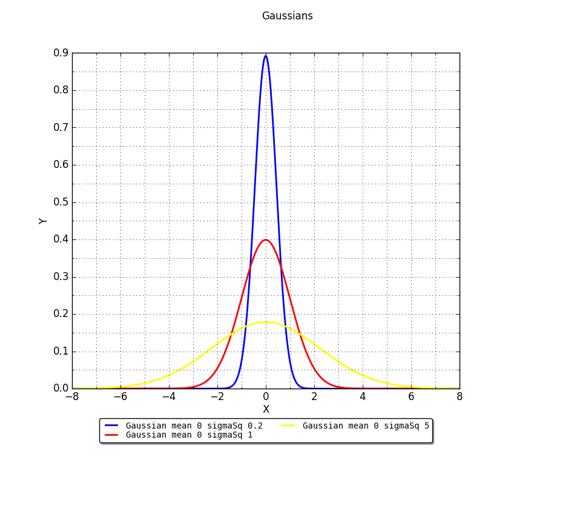
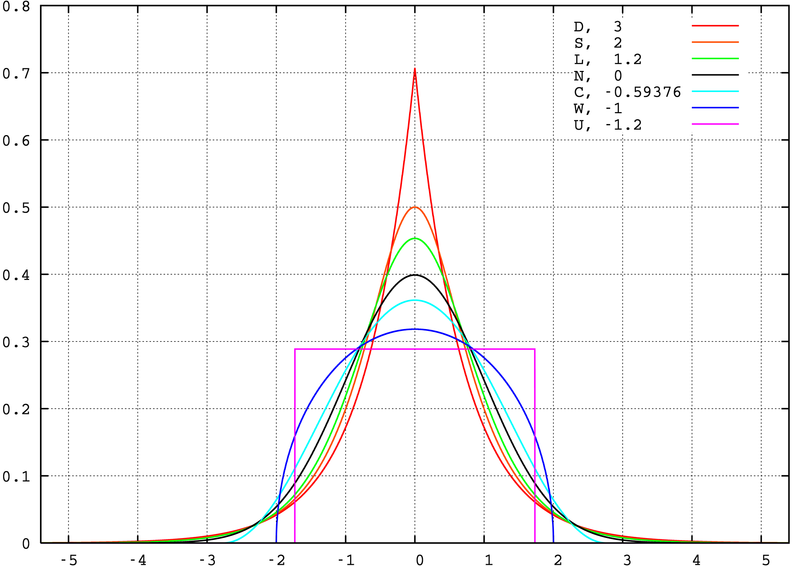

Or "can [daedalean](http://static.sfdict.com/staticrep/dictaudio/D00/D0006100.mp3) words actually help make more accurate descriptions of your random variable? Part 1: [Kurtosis](http://static.sfdict.com/dictstatic/dictionary/audio/ahsd/K/K0007900.mp3)

Is a common belief that gaussians and uniform distributions will take you a long way. Which is understandable if one considers the [law of large numbers](https://en.wikipedia.org/wiki/Law_of_large_numbers): with a large enough number of trials, the mean converges to the expectation. Depending on your reality, you may not have a large enough number of trials. You could always calculate an expected value out of that (limited) number of trials, and for certain conditions on your random variable, you could get a bound on the variation of that expectation, together with a probability of that bound. And that alone is a lot of information on how your random variable might behave.

But you could do a bit more with those expected value calculations! Especially if you have a reason to believe that the best fit for your random variable might not be normal, yet you simply don't have enough samples to commit to a model right now. Could it be that the apparent misbehavior of a random variable is actually a feature instead of a bug?

### Kurtosis: Peakyness, Broad-shoulderness and Heavy-tailedness

Kurtosis (we can use κ interchangeably to denote it) describes both the peakyness and the tailedness in a distribution. κ can be expressed in terms of the expectation:

β\_2 = E(X-μ)^4 / (E(X-μ)^2)^2

Or in terms of the sample means (a.k.a. sample κ):

b\_2 = (Sum((Xi- μ_{hat})^4)/n) / (Sum((Xi-μ_{hat})^2)/n)^2

Kurtosis represents a movement of mass that does not affect the variance and reflects the shape of a distribution apart from its variance. Is defined in terms of an even power of the standard score, so is invariant under linear transformations. Normal distributions have the nice property of having κ = 3. Take the following re-enactment of the [wikipedia illustration for normal distributions](https://en.wikipedia.org/wiki/Normal_distribution):

As you may have guessed from the labels, we have plotted three gaussians with different σ^2 (0.2, 1, 5), all with mean zero. If we draw samples from these distributions and apply the sample κ expressions, we will in all cases get κ ~3. All these three distributions have the same Kurtosis. You can try with sample sizes as small as 9, and move all the way to 1000, 3000 and more. You will still get κ ~3. This is why there is a relative measure called Excess Kurtosis, which is the kurtosis of a distribution with respect that of a normal distribution. And as you may have guessed, is built with  κ - 3.

Distributions with negative  κ - 3 are known as platykurtic. The term "Platykurtosis" refers to the case in which a distribution is Platykurtic. Relative to the normal, platykurtosis occurs with light tails, relatively flatter center and heavier shoulders.

Distributions with excess kurtosis (with a positive κ - 3) are known as leptokurtic. Just as with Platykurtosis, the term "Leptokurtosis" refers to the case in which a distribution is Leptokurtic. When Leptokurtosis occurrs, heavier tails are often accompanied by a higher peak. Is easier to think of hungry tails eating variance from the shoulders/tips or "thinning" them (the greek word "Lepto" means "thin, slender").

So excess kurtosis on most cases captures how much of the variance would go from the shoulders to the tails and to grow the peak (leptokurtosis) or from the tails and the peak height into the shoulders (platykurtosis). Leptokurtosis can either occur because the underlying distribution is not normal, or because outliers are present. So if you are sure that your underlying phenomenon is normal yet you experience leptokurtosis, then you can either re-evaluate your assumptions, or consider the presence of outliers.

### Detecting Bimodality

According to De Carlo (first reference of this post) Finucan in his 1964 "A note on Kurtosis" noted that, since bimodal distributions can be viewed as having heavy shoulders, they should tend to have negative kurtosis. Moreover, Darlington in "Is kurtosis really 'peakedness'?" (1970) argued that excess kurtosis can be interpreted as a measure of unimodality versus bimodality, in which with large negative kurtosis is related to bimodality, with the uniform distribution (κ = -1.2) setting a dividing point.

Discussing Darlington's results and Finucan's note would probably require another post... Let's see how we go for that later :). For now, I think [the following plot from wikipedia](https://en.wikipedia.org/wiki/File:Standard_symmetric_pdfs.png) shows all the former behaviours really nicely:

 

### Kurtosis for assessing normality

Gaussians are like sedans: you can drive them in the city, you can drive them in the highway, you can drive them to the country. They will take you thru many roads. But sometimes you need a proper truck. [Or fabulous roller-skates](https://www.youtube.com/watch?v=ZAISjlN_p8E). And knowing when would you need either can save you from toiling.

Thanks to the higher moments of a distribution, is possible to make relatively cheap tests for normality, even with really small sample sizes. If you wanted to compare the shape of a (univariate) distribution relative to the normal distribution, you can by all means use Excess Kurtosis. Just calculate sample kurtosis for the data you are studying. If it deviates significantly from 3, even for a small number of samples, then you are either not dealing with a gaussian distribution, or there is too much noise for such a sample size.

#### Multivariate normality & multivariate methods

The assumption of normality in the multivariate case prevails in many application fields, often without verifying how reasonable it would be in each particular case. There is a number of other conditions to check for multivariate normality. A property of multivariate normality is that all the marginals are also normal, so this should first be checked (this can be quickly performed with excess kurtosis). Also, linear combinations of the marginals should also be normal, squared Mahalanobis distances have an approximate chi-squared distribution (often q-q plots are used for this purpose), and we can go on. You could even [use this web interface](http://www.biosoft.hacettepe.edu.tr/MVN/) to an R package dedicated exclusively to check multivariate normality.

Kurtosis can affect your study more than you think. When applying a method for studying your random variable, keep in mind that some methods can be more or less affected by the higher moments of the distribution. Some methods are better at dealing with some skewdness (for another post) while some tests are more affected by it. Similarly with Kurtosis. Tests of equality of covariance matrices are known to be affected by kurtosis. Analyses based on covariance matrices (shout out PC Analysis!) can be affected by kurtosis. Kurtosis can affect significance tests and standard errors of parameter estimates.

### Final words

The contents of this post have been influenced by:

- "[On the meaning and use of Kurtosis](http://www.columbia.edu/~ld208/psymeth97.pdf)" by Lawrence T. De Carlo
- https://en.wikipedia.org/wiki/Kurtosis
- http://www.ime.unicamp.br/~cnaber/mvnprop.pdf

Is too bad that I could not find a way to read or buy Finucan's note on kurtosis, because it seemed interesting. If anyone has access to it, please comment and let me know how to get it.
